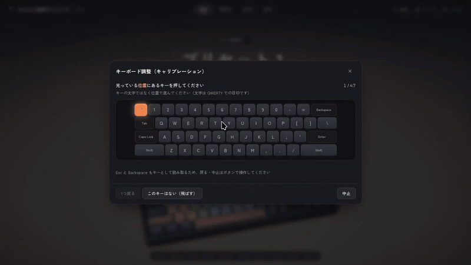
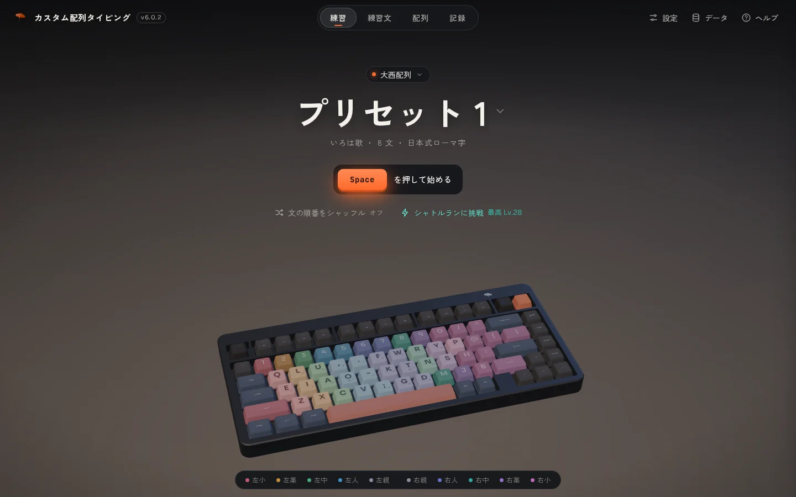
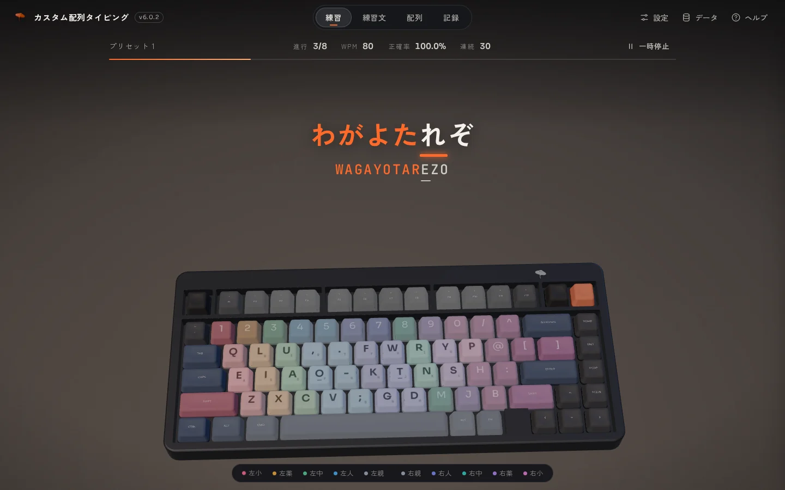
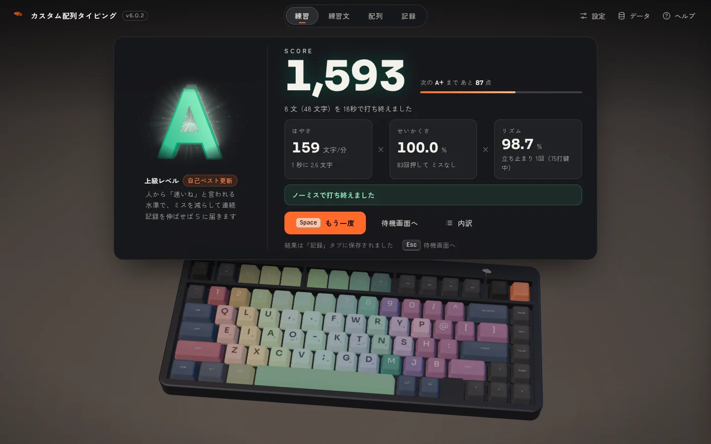
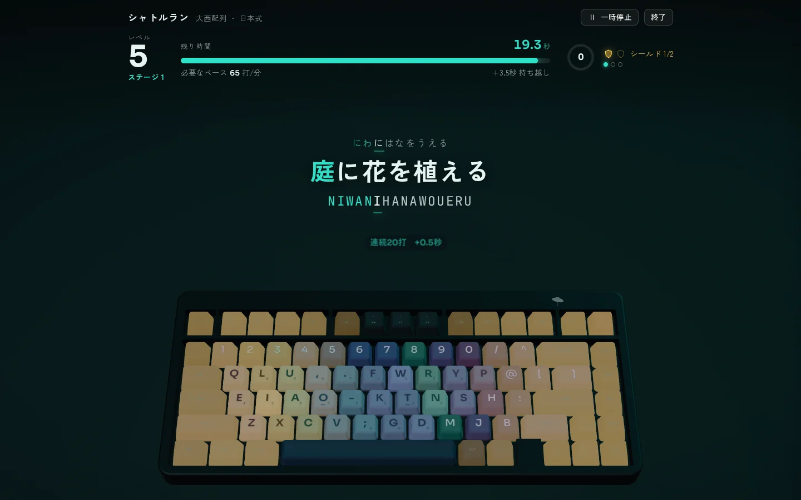
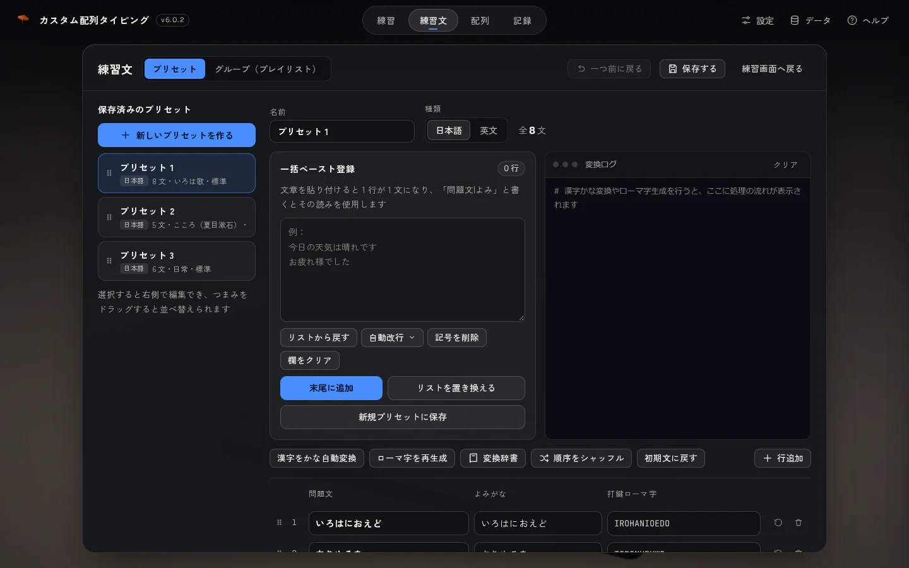
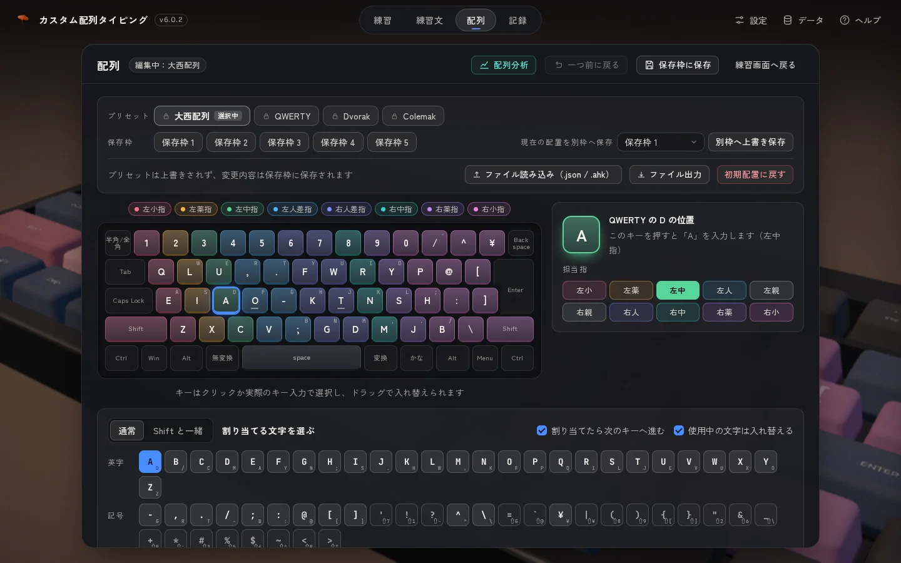
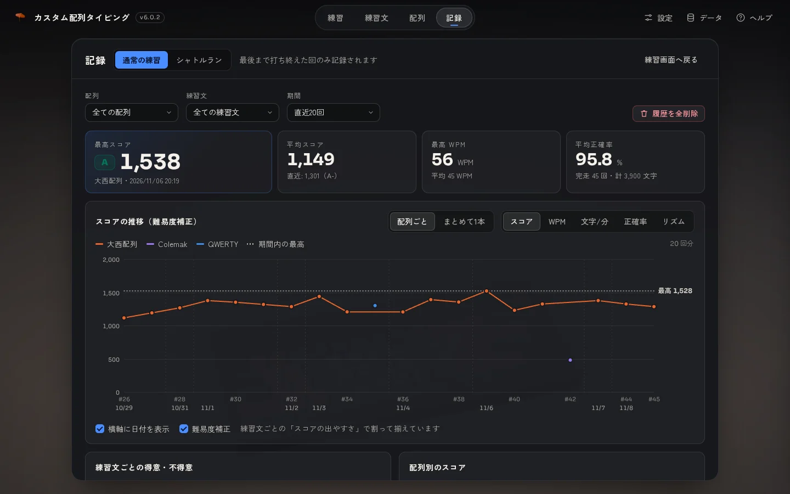
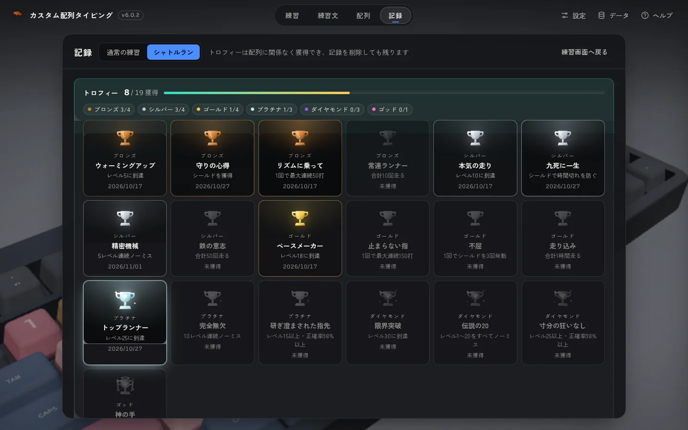

<h1 align="center">カスタム配列タイピング</h1>

<p align="center">
  <a href="https://hemitrygon.github.io/custom-layout-typing/"></a>
</p>
<p align="center">
  
  <a href="LICENSE"></a>
  
  
  
  
</p>

<p align="center">
  <a href="https://hemitrygon.github.io/custom-layout-typing/"></a>
</p>

大西配列・Dvorak・Colemak や自作の配列で、日本語と英文のタイピングを練習するブラウザ用ツール

- 手元のキーボードはそのままで、押したキーの**位置**を、選んだ配列の文字として判定
- 画面の奥に 3D のキーボード：打鍵に合わせて沈み、運指の色で発光
- インストール・会員登録は不要、記録はすべてブラウザの中に保存

**[▶ サイトを開く](https://hemitrygon.github.io/custom-layout-typing/)**（パソコン版の Chrome・Edge・Firefox・Safari の最新版に対応）

---

## 画面

### 練習



待機画面で配列と練習文を選び、Space キーで開始
上の札から配列を、題名からプリセットやグループ（プレイリスト）を切り替え



問題文・よみがな・ローマ字を表示し、打ち終えた文字はオレンジ色に
次に押すキーは 3D キーボードの上で点灯
ローマ字は日本式・ヘボン式のどちらの綴りでも正解（SI / SHI、TU / TSU など）



結果は**速さ × 正確さ × リズム**の総合スコアで採点し、E から SSS まで 18 段階のランクを立体の文字で表示
ミスの多かったキーは、キーボードの上で赤く点灯

### シャトルラン



レベルが上がるごとに、制限時間が短く、文が長くなる持久戦
ノーミスの連続で時間を延長、ノーミスのレベル 3 連続でシールドを獲得し、時間切れを一度だけ回避
残り時間が減るほど、文にひびが入って欠けていく演出つき
到達レベルの記録と、ブロンズからゴッドまで全 19 種のトロフィー

### 練習文



文章を貼り付けるだけで、1 行 1 文の練習文に
漢字は形態素解析（kuromoji.js）で、よみがな・ローマ字へ自動変換
読み違えた言葉は変換辞書に登録して、次回から正しい読みで変換
自動改行（短・中・長）、記号の一括削除、英文のプリセット、複数のプリセットをまとめたグループにも対応

### 配列



VIAL と同じ要領で、キーを選んで文字を割り当てる配列エディタ
ドラッグでキーの入れ替え、Shift と一緒に押したときの文字、担当する指も自由に設定
JSON と AutoHotkey（.ahk）で読み込み・書き出し
配列分析で、ホーム段の使用率・左右の手のバランス・左右交互打鍵率・同指連続率を、実測と理論値で比較

### 記録



スコア・WPM・文字/分・正確率・リズムの推移をグラフで表示し、配列ごとに色分け
難易度補正で、練習文ごとの点の取りやすさをそろえて公平に比較
練習文ごとの得意・不得意と、配列別のスコアも一覧に



シャトルランは、獲得したトロフィーと、配列ごとの最高記録・到達レベルの推移を表示

> 画面の記録は、この README のために用意した見本のデータです

---

## キーボードがすでに別配列のとき

キーボード本体（VIAL・QMK など）や AutoHotkey・Karabiner で配列を変えているときは、画面上部の「**キーボード調整**」を一度だけ実行
光るキーを順に押すと、届く信号と実際のキーの位置の対応を記憶し、キーボード側の設定はそのままで正しく判定
40% キーボードなどで数字や記号をレイヤーから打つときは「**追加のキー**」で登録

---

## データとプライバシー

- 練習の記録・設定・練習文は、使っているブラウザの中（localStorage）にだけ保存し、外部のサーバーへは送信しない
- 右上の「データ」から、バックアップの書き出し・復元と、全データの削除が可能
- 外部から読み込むのは、画面のフォント（Google Fonts）と、「漢字をかな自動変換」を使ったときだけの変換用の辞書（jsDelivr または unpkg、SHA-256 が一致したときだけ使用）の 2 つ
- 前の版（v5）と同じ URL で公開しているので、v5 の記録とバックアップもそのまま引き継ぎ

---

## ファイルの構成

このリポジトリの直下が、そのまま GitHub Pages で公開しているサイトです

| 場所 | 中身 |
|---|---|
| `index.html`・`assets/`・`draco/`・`img/`・`models/` | 公開しているサイト（`source/` からビルドしたもの） |
| `source/` | ソースコード一式（中身は Rust → WebAssembly、画面は three.js ＋ Vite） |
| `source/README.md` | 機能・操作・スコアの計算などを網羅した詳しい説明書 |
| `readme/` | この README の画像 |
| `LICENSE`・`THIRD_PARTY_NOTICES.md` | ライセンス |

### ビルド

Rust（`wasm32-unknown-unknown` のターゲット）・[wasm-pack](https://github.com/rustwasm/wasm-pack)・Node.js が必要です

```sh
cd source/core && wasm-pack build --target web --release
cd ../web && npm install && npm run build   # → source/web/dist/
```

`source/web/dist/` の中身をサーバーに置いて開きます（ファイルを直接開く形では WebAssembly を読み込めません）
開発用の道具の入れ方と一括チェック（`check.sh`）は `source/開発手順.md` に記載
ただし `check.sh` の 7（旧版 v5 のバックアップの引き継ぎ）は、v5 の本体（このリポジトリの過去のコミットにある `source/typing_practice_v5.4.5.html`）を `source/old_versions/` に置いたときだけ動きます

---

## ライセンス

Copyright (C) 2026 Hemitrygon

[GNU General Public License v3.0](LICENSE)（第 3 版またはそれ以降の版、GPL-3.0-or-later）のフリーソフトウェア
GPL の条件のもとで、誰でも自由に使用・複製・改変・再配布が可能
改変したものを配布するときは、そのソースコードも同じ GPL で公開してください
本ソフトウェアは無保証です

- 「Hemitrygon」の名前とロゴ（`img/logo.png`）は GPL の対象外（改変したものを配布するときは、名前とロゴを外してください）
- 使用している第三者のソフトウェアと、そのライセンスの全文：[THIRD_PARTY_NOTICES.md](THIRD_PARTY_NOTICES.md)

| 名前 | 用途 | ライセンス |
|---|---|---|
| three.js | 3D の画面 | MIT |
| Draco（three.js に同梱） | 3D キーボードの圧縮の展開 | Apache-2.0 |
| Vite | ビルド（ページには読み込みの補助のコードだけ） | MIT |
| Rust の標準ライブラリ・wasm-bindgen・serde_json ほか | WebAssembly の中身と JavaScript とのつなぎ | MIT OR Apache-2.0 など |
| kuromoji.js（と辞書） | 漢字のよみがな変換（使うときだけ CDN から読み込み） | Apache-2.0（辞書は mecab-ipadic のライセンス） |
| Zen Kaku Gothic New・Sora・JetBrains Mono | フォント（Google Fonts から読み込み） | SIL Open Font License 1.1 |
| いろは歌・夏目漱石『こころ』の冒頭 | 標準の練習文 | パブリックドメイン |

## AI の使用について

コード・3D の素材・シャトルランの問題文・練習文の一部（プリセット3「日常」）は、AI（Anthropic Claude Code）で生成したものです
設計の判断、動作の確認、公開する内容の確認は、作者が行っています
